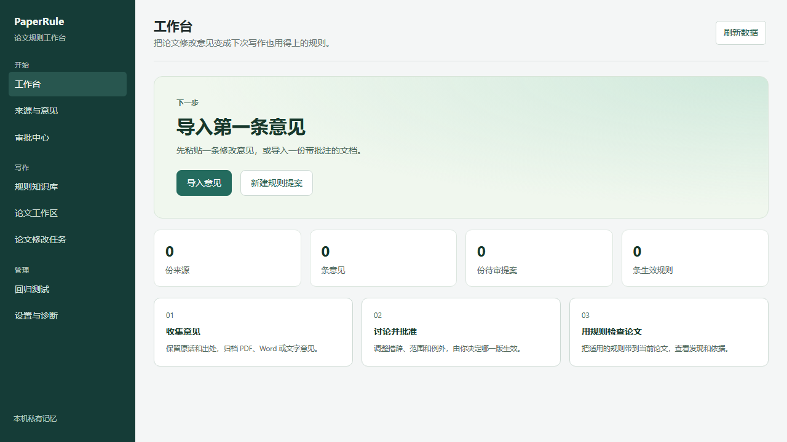

# PaperRule

**Turn this round of revisions into your next pre-submission checklist.**

PaperRule is a Windows manuscript review workspace for independent researchers. Turn supervisor comments, peer reviews, and your own revision notes into reusable writing rules. Check a draft and see **which sentence triggered which rule, with the evidence attached**.

**Windows · Local browser · No account · No API key for the core workflow**

[Quick start](#quick-start) · [Windows setup](docs/installation.md) · [简体中文](README.zh-CN.md)

## From one comment to a reusable check

> Supervisor feedback: “Don't call the result obvious. Explain the derivation or show the evidence.”

1. **Capture the feedback.** Open 来源与意见 (Sources & Feedback), paste the example, save it, and choose 据此创建提案 (Create proposal).
2. **Approve a rule.** Name it “Show the evidence,” choose the fixed phrase check, and use `avoid: obvious` as the rule content. Save the draft and approve the current version in 审批中心 (Approvals).
3. **Review a draft.** Save a sample paper in 论文工作区 (Paper Workspace), paste “It is obvious that our method outperforms the baseline,” and start the review. See the original line and the rule it triggered. This example demonstrates phrase checking; deciding whether the evidence is sufficient is still up to you.

## Why PaperRule?

| Technical feature | What it does for you |
| --- | --- |
| Human-in-the-loop LLM workflow | A configured model can help draft and discuss a proposal. Only the exact version you approve can take effect. |
| Context engineering and versioned rule memory | Select relevant rules by paper, section, and task so that one paper's requirements don't leak into another. |
| Traceable review and regression evaluation | Check a finding against the original line and rule version. Rerun saved examples after changing a rule. |

## Quick start

Follow the [Windows setup guide](docs/installation.md), then double-click `Start PaperRule.cmd`. The app opens in your local browser. The interface is currently in Simplified Chinese; the walkthrough above includes its button labels. Try the example before configuring an AI provider or a GitHub account.

The first release is for one user on one Windows computer. Phrase checks run locally. Optional semantic review uses your configured compatible service and requires explicit permission to send selected content. Checks that did not run are shown as unreviewed.

[Architecture](docs/architecture.md) · [AI provider setup](docs/codex-integration.md) · [Rule scope filters](docs/scope-filters.md)
