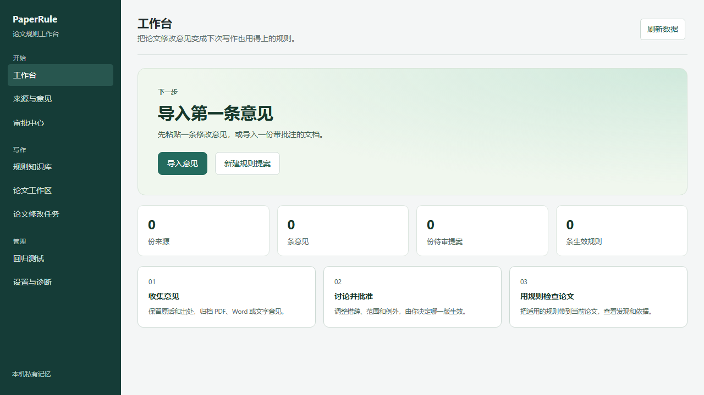

# PaperRule

**改过一次，下篇论文不用再踩同一个坑。**

PaperRule 是给独立研究者用的 Windows 论文审查工具。把导师批注、审稿意见和自己的改稿经验，变成可以批准、复用和追溯的写作规则。投稿前检查文稿，直接看到**哪句话触发了哪条规则、依据是什么**。

**Windows · 本机浏览器 · 不用注册 · 基础流程不用 API Key**

[快速上手](#快速上手) · [Windows 安装](docs/installation.md) · [English](README.md)

## 一条意见，变成可复用的投稿检查

> 导师意见：“不要只说结果显然成立；先交代推导或证据。”

1. **导入意见**：在「来源与意见」粘贴上面的示例，保存后点击「据此创建提案」。
2. **确认规则**：标题填「说明推导或证据」，检查方式选固定词句检查，规则内容填 `avoid: 显然`。保存待审批版本，在「审批中心」批准当前版本。
3. **审查文稿**：在「论文工作区」保存一个示例论文档案，粘贴 `显然，本方法优于对照组。`，开始审查。报告会指出原句、位置和对应规则。这里演示的是固定词句检查，证据是否充分仍由你判断。

## 为什么不用普通聊天框？

| 亮点 | 对使用者有什么用 |
| --- | --- |
| 人工审批的 LLM 工作流 | 配置模型后可一起讨论和起草。只有你明确批准的提案版本才会生效。 |
| 上下文工程与版本化规则记忆 | 按论文、章节和任务选出适用规则，避免把一篇论文的局部要求套用到所有稿件。 |
| 可追溯审查与回归评估 | 回看原句和规则版本，用已保存的案例检查规则迭代是否改变了预期结果。 |

## 快速上手

按 [Windows 安装指南](docs/installation.md) 完成安装，双击 `Start PaperRule.cmd` 启动。页面在本机浏览器打开，工作台会提示下一步。安装后可先用上面的示例体验，无需配置 AI 服务或 GitHub 账号。

首版面向一台 Windows 电脑上的单人使用。基础词句检查在本机运行；使用语义审查需要你配置兼容服务并明确同意发送所选内容。未运行的语义检查会标为未审查。

[架构](docs/architecture.md) · [AI 接入](docs/codex-integration.md) · [规则适用范围](docs/scope-filters.md)
